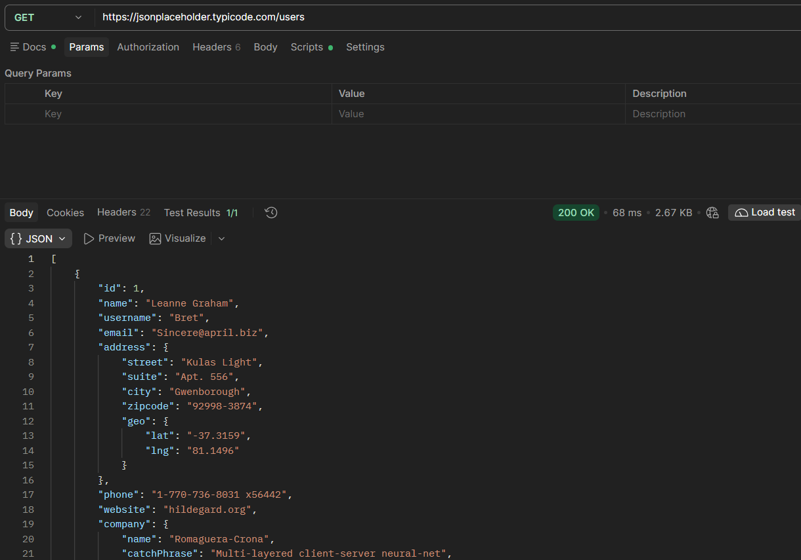
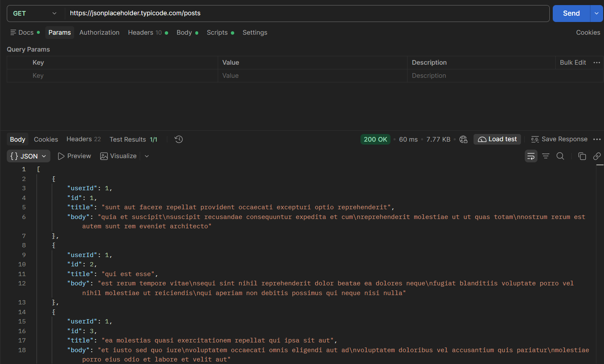
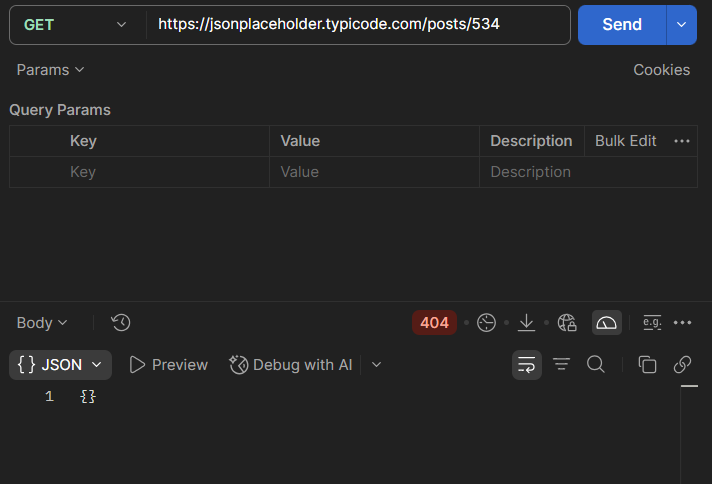
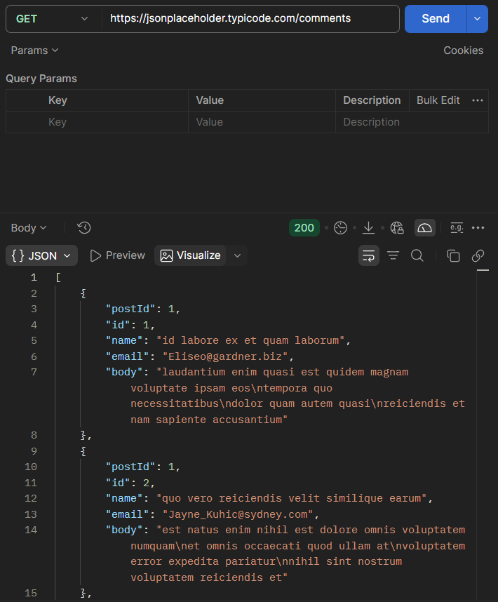
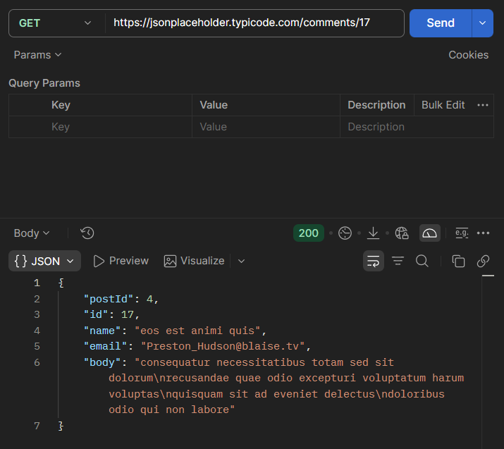

#Postman tasks

### a. Запрос `/users`
Получение списка всех пользователей.

### b. Запрос `/posts`
Получение списка всех постов.

### c. Запрос `/posts/{id}`
Получение конкретного поста по ID (ID = номер группы + номер по журналу). 

### d. Запрос `/comments`
Получение списка всех комментариев.

### e. Запрос `/comments/{id}`
Получение конкретного комментария по ID (ID = номер по журналу).

